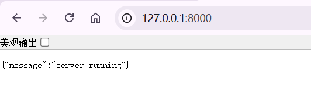
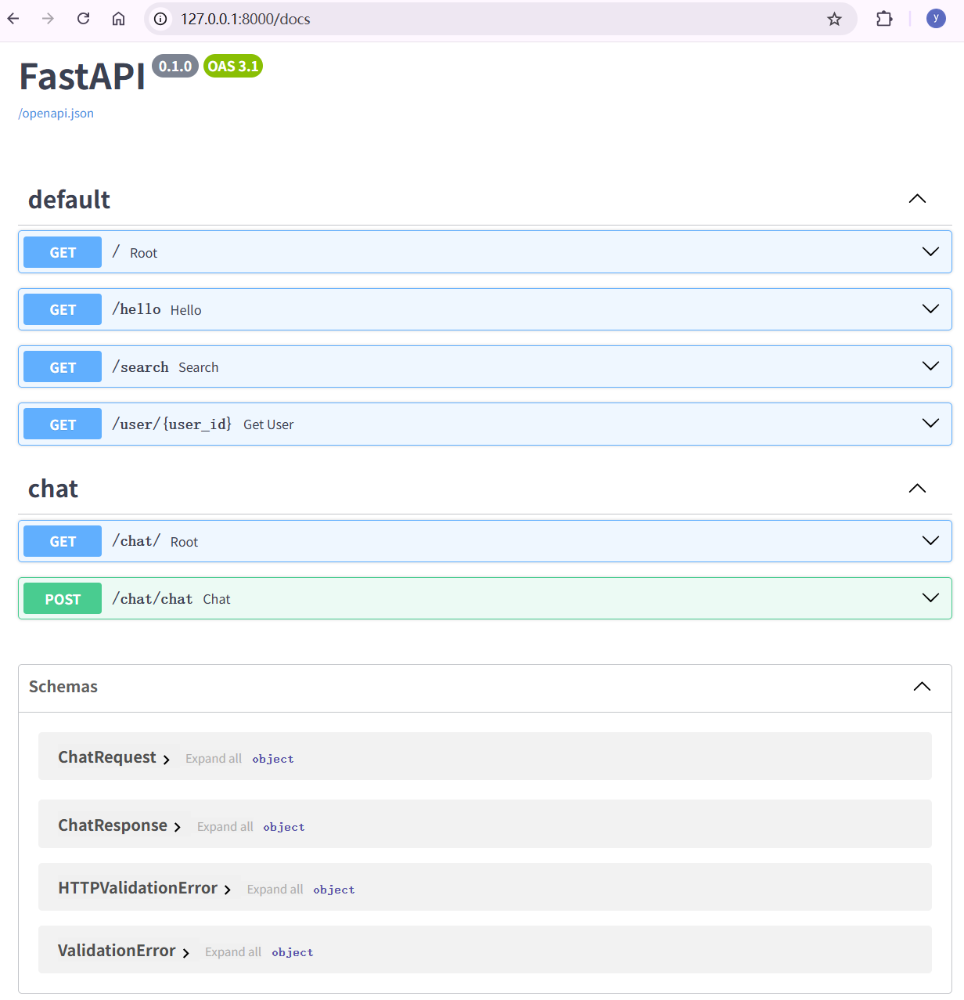

## 启动

```
# 创建虚拟环境
python -m venv .venv

# 安装依赖
python -m pip install -r requirements.txt

# 执行数据库迁移（应用启动时也会自动执行）
alembic upgrade head

# 启动服务
uvicorn main:app --reload
```

访问 http://127.0.0.1:8000/



## 自动化测试

测试使用 pytest，兼容原有 unittest 用例；使用 FastAPI TestClient 和临时 SQLite 数据库，无需启动服务或配置 AI 密钥。

```powershell
# 安装运行和测试依赖（Python 3.11+）
python -m pip install -r requirements-dev.txt

# 执行全部测试 / 只执行数据库测试 / 只执行接口测试
python -m pytest
python -m pytest -m database
python -m pytest -m api

# 输出覆盖率、XML 和 JUnit 报告，供 CI 采集
python -m pytest --cov --cov-report=term-missing --cov-report=xml --junitxml=junit.xml

# Windows 一键执行，可指定独立测试环境
./scripts/test.ps1 -Python ./.venv/Scripts/python.exe -Coverage
```

`tests/conftest.py` 在导入应用前将 `DB_PATH` 指向临时目录，覆盖测试环境与 AI 密钥。`database` fixture 为每个用例分配独立数据库，并使用 Alembic 初始化。`client` fixture 执行真实的应用启动、迁移与关闭流程，AI 响应使用 mock，并阻止 HTTPX 发出真实网络请求。测试不会读写 `data/chat.db`，Engine 释放后清理临时文件。

测试覆盖普通/多轮聊天、请求校验、会话查询与删除、SSE 事件和落库、AI 异常、流式失败及提交失败回滚、SQLite 外键和非空约束、级联删除、Session 生命周期，以及新库/旧库迁移和结构一致性。`database` 标记包含数据库集成及接口落库测试。

测试失败时退出码非零；CI 可执行上述 pytest 报告命令。生成的报告和缓存已加入忽略规则。

测试临时文件统一放在项目的 `.test-tmp/run-*` 独立目录，结束后自动清理，避免 Windows 系统临时目录 `pytest-of-*` 的访问权限问题。也可通过 `--basetemp` 显式指定 pytest 临时目录；pytest 会清空该指定目录，请仅使用专门的测试目录。

## 项目结构

```
backend/
│
├── main.py              ← FastAPI 应用入口
│
├── api/
│     chat.py            ← 路由（Route）
│
├── services/
│     ai_client.py       ← 调用 OpenAI
│     chat_service.py    ← 负责 AI 对话的业务流程，属于业务编排层
|     memory_store.py    ← 负责对话历史的持久化存储和管理，属于数据持久化层
│
├── models/
│     schemas.py         ← Pydantic 模型
│
├── db/
│     orm_models.py      ← 数据库表定义
│     database.py        ← 数据库连接、Session 工厂和迁移入口
│     migrations.py      ← 使用应用 Engine 执行 Alembic 升级
│
├── alembic.ini          ← Alembic 配置
├── migrations/
│     env.py             ← 迁移环境，复用应用配置和 ORM 元数据
│     versions/          ← 可追踪的数据库版本历史
│
├── core/
│     config.py          ← Pydantic Settings 配置
│     logger.py
│     paths.py           ← 统一管理项目路径
```

main.py 只负责：
- 创建 FastAPI 应用
- 启动时升级数据库版本
- 注册路由
- 做应用初始化（日志、配置、中间件等）

它只是**把整个应用组装起来**

## 整个调用链

```
浏览器
      │
      ▼
POST /chat
      │
      ▼
api/chat.py(Route)
      │
      ▼
ChatService(业务)
      │
      ▼
AIClient(OpenAI SDK)
      │
      ▼
OpenAI API
```

```
OpenAI API
      │
      ▼
AIClient
      │
      ▼
ChatService
      │
      ▼
Route
      │
      ▼
浏览器
```

chat_service 和 memory.store.py 调用关系：
```
  api 接口
     ↓
  ChatService
  chat()/chat_stream()
   ↓                ↓
MemoryStore       AIClient
保存/读取对话      调用大模型
会话管理           生成回复
   ↓                ↓
Database          LLM Provider
```
- ChatService 接收消息，组织上下文，调用AI，返回回复
- MemoryStore 保存消息，读取历史，管理会话
- AIClient 与大模型交互
- Database 提供数据库会话

## 技术栈
|领域 |选型 |说明 |
| --- | --- | --- |
|Web 框架 |FastAPI 0.139 + Uvicorn |ASGI，自带 OpenAPI 文档 |
|数据校验 |Pydantic v2 |请求/响应模型与类型契约 |
|AI SDK |openai 2.44 |通过 base_url 复用同一 SDK 调 DeepSeek |
|数据库 |SQLite + SQLAlchemy 2 ORM + Alembic |Session 管理事务，Alembic 管理表结构版本 |
|流式传输 |SSE（StreamingResponse） |text/event-stream + 生成器 |
|配置 |python-dotenv |.env 注入密钥与开关 |

## 核心思路

数据库访问封装在 `MemoryStore`，`ChatService` 继续使用原有接口。`db/orm_models.py` 定义 ORM 模型，`db/database.py` 管理连接、Session 工厂和迁移入口。路由通过依赖注入获取请求级 Session，数据库层负责创建、异常回滚和关闭；业务层显式提交事务。普通聊天在返回前提交整轮对话，流式聊天在发送 done 前提交，删除会话在返回前提交；会话删除通过数据库外键级联删除消息。

`db/database.py` 定义进程级共享的 `database` 实例及 Engine，FastAPI lifespan 将其注册到 `app.state.database`，退出时释放 Engine。启动时调用 `init_db(database)`，通过 Alembic 执行 `upgrade head`；版本记录存储在 `alembic_version` 表。迁移失败会阻止服务启动。应用不再调用 `create_all()`，修改模型后必须新增迁移文件并提交到版本控制。

- `system prompt` 放在 prompts/system.md，不要写死在代码里。
- `多轮对话` 不应该由前端每次传一大堆历史，而是先由后端根据 conversation_id 管理。
- `聊天记录保存` 用 SQLite / PostgreSQL。
- `流式输出` 先在后端用 FastAPI 的 StreamingResponse，前端再用 fetch 读取 stream
- `React 前端` 只负责输入、展示、调用 /chat 或 /chat/stream，不要放 AI 逻辑。

## 数据库迁移

以下命令在项目根目录、使用项目虚拟环境执行。CLI 和应用都从 `core.config.settings.db_path` 读取数据库路径，默认是 `data/chat.db`，可通过 `.env` 或环境变量 `DB_PATH` 覆盖；相对路径相对于当前工作目录。迁移目录通过 `alembic.ini` 的位置定位。

```powershell
# 查看当前版本和迁移历史
python -m alembic current
python -m alembic history

# 修改 db/orm_models.py 后生成迁移
python -m alembic revision --autogenerate -m "add conversation field"

# 检查生成的 upgrade/downgrade 后应用迁移
python -m alembic upgrade head

# 检查数据库与 ORM 模型是否一致
python -m alembic check

# 回退一个版本；请先停服务并备份数据库
python -m alembic downgrade -1
```

`0001` 是初始迁移：空数据库直接建表；项目早期手写 SQL 创建的数据库会先检查表结构，再复制到与 ORM 一致的新表，保留会话、消息 ID、时间值、自增序号和 `schema_migrations` 历史表。复制和替换在同一事务中执行，外键始终开启。未知结构、额外字段或触发器会阻止自动接管，需为实际结构编写迁移。首次升级旧库前应停止服务并备份 SQLite 文件；测试在临时数据库和副本上执行。

如果数据库已经由旧版 `Base.metadata.create_all()` 建成，且确认字段、约束和索引与 `migrations/versions/0001_initial_schema.py` **完全一致**，备份后可用 `python -m alembic stamp 0001` 登记初始版本，再执行 `python -m alembic upgrade head` 和 `python -m alembic check`。`stamp` 只写版本号，不修改结构，不能用于跳过结构差异。

迁移环境开启 `render_as_batch=True`，自动生成的 SQLite 字段变更使用 batch 模式。自动生成不能可靠识别重命名，必须人工检查；涉及被引用的父表重建时，还需安排外键和数据复制顺序。[Alembic SQLite batch 文档](https://alembic.sqlalchemy.org/en/latest/batch.html)

`downgrade base` 会删除会话和消息表。应用启动会重新升级到 head，因此回退数据库时应同时部署匹配版本的代码。

## 调用 DeepSeek API

DeepSeek API 使用与 OpenAI/Anthropic 兼容的 API 格式，通过修改配置，可以使用 OpenAI/Anthropic SDK 来访问 DeepSeek API

```python
# Please install OpenAI SDK first: `pip3 install openai`
import os
from openai import OpenAI

client = OpenAI(
    api_key=os.environ.get('DEEPSEEK_API_KEY'),
    base_url="https://api.deepseek.com")

response = client.chat.completions.create(
    model="deepseek-v4-pro",
    messages=[
        {"role": "system", "content": "You are a helpful assistant"},
        {"role": "user", "content": "Hello"},
    ],
    stream=False,
    reasoning_effort="high",
    extra_body={"thinking": {"type": "enabled"}}
)

print(response.choices[0].message.content)
```

https://api-docs.deepseek.com/zh-cn/

## 流式输出

流式输出的核心思想：生成器不断 yield 新的数据，StreamingResponse 每得到一个值就立即发送给客户端
