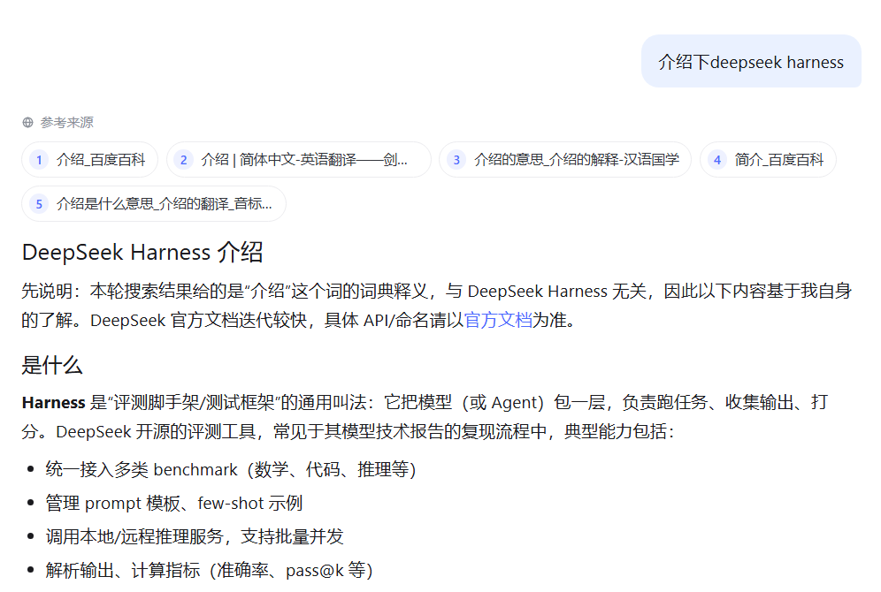
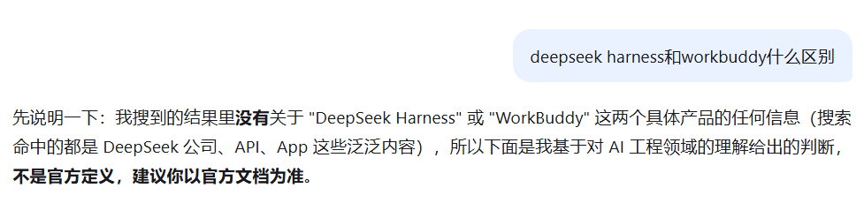

# 联网搜索实现方案

> 适用仓库：`ai-chat-backend`（FastAPI）+ `ai-chat-frontend`（React / Vite）。
> 本文覆盖联网搜索的完整实现链路，并重点说明「搜索结果与问题不匹配」的三类成因、复现证据与处理方案。
> 文中代码索引均为当前仓库真实存在的文件与符号。

---

## 1. 目标与边界

**目标**：让用户在聊天时可选地开启「联网搜索」，后端实时检索网页、把可信结果注入本轮回答，并以可追溯的来源形式展示；搜索失败不阻塞聊天。

**边界（刻意不做的事）**：

- 搜索结果**只注入当前轮的系统提示词**，不写入会话记忆，避免历史消息被过期网页污染、避免上下文无限膨胀。
- 不做全网爬虫 / 正文抓取，只取搜索引擎返回的标题 / 链接 / 摘要（snippet）。
- 不依赖模型厂商的内置搜索（见 §3 选型）。
- 搜索是**增强**而非**前置条件**：任何失败都降级为普通回复。

---

## 2. 总体架构

```
前端 composer「联网搜索」开关 (localStorage: ai-chat:web-search)
        │  POST /chat/stream  { message, web_search:true, conversation_id? }
        ▼
api/chat.py ── StreamingResponse(text/event-stream)
        ▼
services/chat_service.py  ChatService
   ├─ ① 搜索词改写   _extract_search_queries()   ← AIClient.chat(小提示词)
   │        └─ 失败/为空 → 启发式 build_search_query + split_search_entities
   ├─ ② 逐实体搜索   _search_context()
   │        ├─ WebSearchService.search(query)      (Tavily / Bing)
   │        ├─ 噪声门控 results_mention_query()    → 精确匹配重试 → 仍噪声则丢弃
   │        └─ URL 去重 + 轮转合并 (cap = max_results*2)
   ├─ ③ 提示词注入   _build_search_prompt()        (仅本轮 system_prompt)
   ├─ ④ 流式回复     AIClient.chat_stream()        (delta…)
   └─ ⑤ 落库        messages.sources / messages.search_query  → commit
        ▼
SSE: start → search_start → search_result|search_error → delta… → done
        ▼
前端：搜索状态条 → 回答末尾「N 个网页」收起胶囊 → 点击展开右侧「搜索结果」抽屉
历史回放：GET /conversations/{id}/messages 返回 sources / search_query → 同样渲染
```

关键文件：

| 层 | 文件 | 职责 |
| --- | --- | --- |
| 配置 | `core/config.py` | `search_*` / `tavily_api_key` 设置项 |
| 搜索 | `services/web_search.py` | Tavily / Bing 两后端、URL 解码、搜索词聚焦、实体拆分、相关性门控 |
| 编排 | `services/chat_service.py` | 改写、逐实体搜索、合并、提示词注入、SSE、落库 |
| 模型 | `models/schemas.py` | `ChatRequest.web_search`、`SearchResult`、`Message.sources/search_query` |
| 存储 | `services/memory_store.py`、`db/orm_models.py` | 来源与搜索词随助手消息持久化 |
| 迁移 | `migrations/versions/0006_message_search_sources.py` | `messages.sources`(JSON) / `messages.search_query`(Text) |
| 路由 | `api/chat.py`、`api/conversations.py` | `/chat/chat`、`/chat/stream`、`/conversations/{id}/messages` |
| 前端 | `src/api/chat.ts`、`src/App.tsx`、`src/App.css`、`src/Icons.tsx` | SSE 解析、搜索状态、收起胶囊、右侧抽屉 |

---

## 3. 搜索后端选型

| 方案 | 说明 | 结论 |
| --- | --- | --- |
| **Tavily** | 面向 LLM 优化的搜索 API，需 `TAVILY_API_KEY`，返回结构化 title/url/content | 配了密钥优先用 |
| **Bing 网页搜索** | 免密钥，抓取 HTML 解析 `li.b_algo`，解码 `/ck/a` 跳转链接 | 默认回退，零成本 |
| **DeepSeek 原生搜索** | 是**独立按次计费**的搜索接口，并非 chat completions 的内置工具；接入需额外付费与另一套调用链 | 不采用 |

`search_provider=auto`（默认）：有 `TAVILY_API_KEY` → Tavily，否则 Bing；也可显式 `tavily` / `bing`。

### 配置项（`core/config.py` / `.env.example`）

| 环境变量 | 默认 | 含义 |
| --- | --- | --- |
| `SEARCH_PROVIDER` | `auto` | `auto` / `tavily` / `bing` |
| `TAVILY_API_KEY` | 空 | Tavily 密钥；空则 auto 回退 Bing |
| `SEARCH_MAX_RESULTS` | `5`（1–10） | 单实体返回条数；合并上限为其 2 倍 |
| `SEARCH_TIMEOUT` | `10`（1–60）秒 | 单次搜索超时 |
| `SEARCH_TRUST_ENV` | `false` | **默认直连**。实测系统代理会给 Bing 返回缓存的无关结果；必须经代理出网时才设 `true` |

Bing 抓取要点（`web_search.py::_search_bing`）：浏览器 UA + `Accept-Language: zh-CN`；`follow_redirects=True`；xpath `//li[@class="b_algo"]` 取 `h2/a`；`_decode_bing_url` 把 `/ck/a?u=a1<base64>` 还原为真实 URL；摘要取 `b_caption//p` 或 `//p`；`_clean` 折叠空白。任何异常统一抛 `WebSearchError`，由上层降级。

---

## 4. 搜索词处理流水线

用户原话往往不是好的搜索词。流水线分三级：

### 4.1 模型改写（主路径）

`chat_service.py::_QUERY_EXTRACT_PROMPT`：

> 你是搜索词提取器。把用户消息改写成简洁的搜索引擎查询词，只保留要查询的主题或实体，去掉口语、态度、祈使等无关外壳。若消息涉及多个实体或比较（如 A 和 B 的区别），为每个实体各输出一条查询词，用 | 分隔；否则只输出一条查询词。不要解释、不要引号、不要句末标点。若消息已是清晰的主题词，原样输出。

- `_clean_extracted_query`：取首个非空行 → 剥离引号/句末标点字符集 → 折叠空白 → 截断 100 字符。
- `_parse_extracted_queries`：按 `|` 切分 → 逐条 clean → 去重 → 截断 `_MAX_ENTITIES=3`。
- 一次额外的小模型调用完成改写；**失败或输出为空**时进入 4.2 回退，不阻塞。

代价是每条开启搜索的消息多一次廉价模型调用(一点延迟 + 少量 token)。

### 4.2 启发式聚焦（回退）

`web_search.py::build_search_query`：迭代剥离中英文祈使/疑问外壳（`_LEADING_FILLER` / `_TRAILING_FILLER` / `_EN_*`，各最多 6 轮），再 strip 标点；剥空或过短（<2）退回原消息。

### 4.3 启发式实体拆分（回退的拆分）

`web_search.py::split_search_entities`：按连接词 `和 / 与 / 跟 / 、 / vs / versus / and / &` 切分，再剥结尾比较词（`什么区别 / 的区别 / 差异 / 哪个好 / 对比 / 比较 …`），去重；单实体原样返回。

> 设计取舍：词表黑名单**不可能穷尽口语**（见 §6 问题二），因此主路径交给模型改写，词表只作兜底，二者互补。

---

## 5. 多实体拆分搜索 + 合并来源

比较类问题（「A 和 B 什么区别」）若把整句或拼接词当**一条**查询，Bing 召回极差（退化成泛泛公司页）。因此：

1. 改写输出多条查询词（`|` 分隔，≤3）；回退时用 `split_search_entities`。
2. **逐实体独立搜索**，每个实体拿到自己的结果列表。
3. **合并**（`chat_service.py::_search_context`，约 L186）：
   - 按 URL 去重（`seen` 集合）；
   - **轮转（round-robin）** 交错取各实体第 i 条，保证每个实体在头部都有代表；
   - 上限 `cap = max_results * 2`（默认 5→10）；
   - 某实体抛 `WebSearchError` 只记录 `first_error`，不影响其余实体。
4. 展示标签 `label = " / ".join(queries)`（如 `deepseek harness / workbuddy`），**复用同一 SSE 字段与落库列**，前端无需为多实体做特殊处理。

---

## 6. 搜索结果不匹配：问题、证据与处理方案（核心）

联网搜索上线后实际遇到四类「搜到的不是想要的」问题。以下均有线上复现证据。

### 问题一：答非所问


直接把「介绍下deepseek harness」整句当搜索词，会被口语外壳带偏搜成「介绍」

原因在于：
1. **检索查询词过于宽泛**：请求中直接包含“介绍下…”这类指令词，搜索引擎容易把核心词拆散（如直接拆出“介绍”），匹配到大量词典定义或百科词条。
2. **缺少系统提示词引导**：在自定义聊天应用中，如果只传递了 `web_search: true` 和用户原话，模型缺乏上下文，容易优先依赖搜索结果里最显著的内容，甚至直接带出检索头部的搜索说明。
3. **DeepSeek 联网机制的特点**：DeepSeek 官方联网搜索并不是单纯返回链接列表，而是把检索片段回填到特定模板中重新调用模型生成。如果缺少质量约束，模型容易被动照搬低相关度的材料。

### 问题二：口语整句被当搜索词，词表剥不干净

- **现象**：用户说「我不懂deepseek harness」，搜索词仍带口语外壳，召回与主题无关。
- **成因**：`_LEADING_FILLER/_TRAILING_FILLER` 是**有限黑名单**，使用词表剥掉祈使/疑问外壳，覆盖不了任意口语（「我不懂…」「…靠谱吗」等）。
- **处理**：主路径改为 **LLM 改写**（§4.1），把任意口语收敛为主题词；词表剥离降级为改写失败/为空时的回退（§4.2）。
- **验证**：集成测试 `test_stream_search_query_uses_llm_rewrite`（「我不懂deepseek harness」→ 搜索词 `deepseek harness`）；改写抛错/输出空白时回退仍得到主题词。

```python
_LEADING_FILLER = (
    "请问一下", "请帮我查一下", "请帮我", "请问",
    "帮我查一下", "帮我查下", "帮我查查", "帮我查", "帮我看看", "帮我",
    "帮忙查一下", "帮忙查下", "帮忙",
    "告诉我一下", "告诉我",
    "介绍一下", "介绍下",
    "简述一下", "简述下",
    "解释一下", "解释下",
    "说明一下", "说明下",
    "分析一下", "分析下",
    "对比一下", "对比下",
    "推荐一下", "推荐下",
    "总结一下", "总结下",
    "了解一下", "了解下",
    "讲一下", "讲下", "讲讲",
    "说一说", "说说",
    "聊一聊", "聊一下",
    "查一下", "查下", "查查",
    "查询一下", "查询下",
    "查找一下", "查找下",
    "搜索一下", "搜索下",
    "搜一下", "搜下",
    "什么是", "何为",
)

_TRAILING_FILLER = (
    "是什么意思", "什么意思", "是什么",
    "怎么样", "怎样", "如何",
    "好不好", "好吗",
    "一下", "下",
    "吗", "呢", "吧", "啊", "呀",
    "？", "?", "。", "！", "!", "，", ",",
)
```

### 问题三：多实体组合查询召回差（比较类问题）

- **现象**：问「deepseek harness和workbuddy什么区别」，来源全是泛泛的 DeepSeek 公司页 / 百科页，**没有 WorkBuddy**。
- **证据**：真实 Bing 探针对比——组合查询（原句或改写后的 `deepseek harness workbuddy 区别`）返回同一批 generic DeepSeek 页；而**单独**搜 `deepseek harness`、`workbuddy` 各自都精准（官网 / 文档 / GitHub / 教程）。
- **成因**：Bing 对「A和B区别」这类多实体组合查询的排序/召回能力差，不是改写的问题。
- **处理**：**多实体拆分搜索 + 合并来源**（§5）。拆开后每实体独立召回，再轮转合并，保证两产品都有代表。
- **验证**：真实 Bing 探针合并 10 条、两产品官网均在列；集成测试覆盖拆分/去重/轮转/部分失败/回退。

### 问题四：裸品牌词偶发返回无关噪声 SERP（最隐蔽）




- **现象**：拆分已生效（来源呈 harness/JD 交替 = 两腿轮转合并的特征），但 `workbuddy` 那一腿返回**京东首页/登录页簇**，噪声被合并进来源并误导模型（模型回复「WorkBuddy 基本没有可靠来源，返回的几乎全是京东页面」）。
- **证据**：
  - 线上落库（`data/chat.db`）该轮 `sources` 为 harness 与 `jd.com / home.jd.com / new.jd.com / order.jd.com / h5.m.jd.com` 交替；
  - 同一查询 `workbuddy` 在另一些请求返回 `workbuddy.cn` 官网簇（直连探针多次复现良好结果）；
  - 走系统代理（`trust_env=True`）时返回 **ChatGPT/dify-on-wechat 垃圾簇**——即代理缓存污染。
- **成因**：两个叠加因素——
  1. **Bing HTML SERP 不稳定**：同一裸品牌词在不同请求/边缘节点下可能返回无关门户页；
  2. **系统代理缓存污染**：代理对 Bing 返回缓存的无关结果（故默认 `SEARCH_TRUST_ENV=false` 直连）。
- **处理**（`chat_service.py::_search_context` + `web_search.py::results_mention_query`，约 L254）：
  1. **相关性门控**：把查询词切成词元（`[^0-9a-z一-鿿]+`，长度≥2），若**所有**结果的标题/链接/摘要都不含任何词元 → 判定为噪声 SERP。只要有一条提及即信任该 SERP（避免误杀同义改写）。
  2. **精确匹配重试一次**：噪声时用 `"实体"`（加引号强制精确匹配）重搜；URL/查询变化可避开缓存与坏边缘。
  3. **仍噪声则丢弃该实体**：绝不把垃圾来源注入提示词；其余实体照常合并。
  4. **全部实体无可靠结果** → 返回「未找到相关搜索结果」，走 `search_error` 降级；若全是异常则返回 `first_error`（如「联网搜索暂时不可用」）。
- **验证**：
  - 用线上落库的真实 JD 簇做探针：`results_mention_query("workbuddy", jd簇) == False`（门控能识别用户那次坏 SERP）；
  - 真实 Bing `workbuddy` 与 `"workbuddy"` 均返回官网簇（重试变体有效）；
  - 集成测试：噪声→重试替换、重试仍噪声→丢弃、全噪声→降级、门控参数化单元。

### 问题—方案对照表

| # | 问题 | 根因 | 处理 | 关键符号 |
| --- | --- | --- | --- | --- |
| 1 | 口语整句搜偏 | 有限词表覆盖不全 | LLM 改写 + 词表回退 | `_QUERY_EXTRACT_PROMPT` / `build_search_query` |
| 2 | 比较类组合查询召回差 | Bing 多实体组合召回弱 | 拆分逐实体搜 + 轮转合并 | `split_search_entities` / `_search_context` |
| 3 | 裸品牌词噪声 SERP / 代理缓存 | Bing 不稳定 + 代理污染 | 相关性门控 + 精确重试 + 丢弃 + 默认直连 | `results_mention_query` / `SEARCH_TRUST_ENV` |
| 4 | 切换会话丢来源 | 来源未持久化 | 落库 + 历史回放 | `messages.sources/search_query` / 迁移 0006 |

---

## 7. 提示词注入与引用

`_build_search_prompt(label, sources)`：在原系统提示词后追加「# 联网搜索参考」块——说明搜索词、要求**优先参考结果并用 Markdown 链接 `[标题](url)` 标注来源**、提醒结果可能过时/无关需自行甄别、不足时结合自身知识并说明。逐条 `[i] 标题 / URL / 摘要`，摘要截断 `_SNIPPET_LIMIT=400` 防撑爆上下文。

- 注入只发生在**本轮** `system_prompt`；发给模型的 `messages` 历史保持干净（测试断言）。
- 来源同时经 SSE / 响应体 / 落库三条通道给到前端，供展示与回放。

---

## 8. SSE 事件契约与前端展示

### 事件顺序（`/chat/stream`）

| 事件 | 载荷 | 时机 |
| --- | --- | --- |
| `start` | `conversation_id` | 立即，便于新会话前端拿 ID |
| `search_start` | `query`（启发式 provisional） | 开启搜索时立即，前端显示「正在联网搜索」 |
| `search_result` | `query`（最终拼接标签）+ `results[]` | 搜索+门控+合并完成 |
| `search_error` | `message` | 全失败/全噪声/无结果；随后仍普通回复 |
| `delta` | `content` | 流式增量 |
| `done` | `conversation_id` + `usage` | 落库 commit 成功后 |

非流式 `/chat/chat` 用响应体 `sources` 字段返回来源。

### 前端（`App.tsx` / `App.css`）

- 开关偏好存 `localStorage: ai-chat:web-search`，默认关。
- `searchState`: `searching`（spinner + provisional 搜索词 chip）/ `done` / `error`（黄色降级提示）。
- **收起态**（回答末尾）：`SourcesPill`（约 L152）= 重叠站点图标堆叠（≤4 个去重域名）+「N 个网页」+ 右箭头；整枚为按钮。
- **展开态**：`SourcesDrawer`（约 L193）右侧滑出「搜索结果」面板——头部标题 + 搜索词副标题 + 关闭；卡片含 favicon / 域名 / 序号徽标 / 两行标题 / 两行摘要；整卡 `target=_blank` 打开原文；自定义滚动条；遮罩 / X / Escape 三种关闭；移动端全宽。
- **Favicon 降级**（约 L127）：优先 `origin/favicon.ico`，`onError` 降级为域名首字母彩色头像（域名哈希取色），保证离线/图标缺失也不破图。
- 切换会话 / 新建对话自动收起抽屉，避免串会话。

---

## 9. 持久化与历史回放

- `db/orm_models.py::MessageRecord` 增 `sources: JSON nullable`、`search_query: Text nullable`；迁移 `0006_message_search_sources`（已应用于 `ai_chat` 与 `ai_chat_test`）。
- `memory_store.add_message` 写 `sources=[s.model_dump()…] or None`、`search_query`；`get_messages` 读回 `sources=row.sources or []`。
- `GET /conversations/{id}/messages` 返回两字段；前端 `selectConversation` hydrate 出 `sources/searchQuery/searchState=done`，历史与实时渲染一致（来源在回答末尾、切换不丢）。
- 一轮对话（用户消息 + 助手消息 + token 用量）作为**一个事务** commit 后才返回/发 `done`；commit 失败由 Session 依赖回滚、不发 `done`。

---

## 10. 降级与容错矩阵

| 场景 | 行为 |
| --- | --- |
| 未开搜索 | 不改动提示词，`sources=[]`，不调搜索/改写 |
| 改写调用失败 / 输出空 | 回退启发式聚焦+拆分，继续搜索 |
| 单实体搜索抛错 | 记 `first_error`，其余实体照常 |
| 单实体噪声 SERP | 精确匹配重试一次 |
| 重试仍噪声 | 丢弃该实体，不注入垃圾 |
| 全部实体异常 | `search_error(first_error)` + 普通回复 |
| 全部无可靠结果 | `search_error(未找到相关搜索结果)` + 普通回复 |
| 搜索超时 | `SEARCH_TIMEOUT` 触发 `WebSearchError` → 同上降级 |

原则：**搜索永远不阻塞聊天**；宁可少来源，不可给错来源。

---

## 11. 测试与验证

- **单元/集成**：`tests/test_chat_web_search.py`、`tests/test_web_search.py` 等；mock AI、`conftest` 阻断真实 httpx；全量 **181 passed**（含 PostgreSQL `ai_chat_test` 集成、迁移 head=0006 断言）。
- **真实 Bing 探针（零 AI 配额）**：验证组合 vs 拆分召回、噪声门控对线上落库 JD 簇的识别、plain/quoted 重试变体。
- **无头 Edge + CDP（mock SSE）**：桌面 1440 / 移动 390 实测搜索状态、收起胶囊、抽屉打开/三种关闭、历史保留、无横向溢出、0 应用报错。
- 测试数据库仅用 `ai_chat_test`；真实数据 `ai_chat` 只读用于取证。

---

## 12. 已知局限与可选演进

- **Bing HTML 抓取本质不稳定**：门控+重试只能缓解，不能根除；追求稳定可配 `TAVILY_API_KEY` 切 Tavily，或自建 SearXNG。
- **无发布日期字段**：`SearchResult` 仅 title/url/snippet，抽屉不展示日期（不臆造）；如需时效性可扩展 provider 返回 date。
- **favicon 依赖站点自身**：缺失时降级字母头像，属预期行为。
- **相关性门控是词元匹配**：对同义/译名召回可能误判为噪声；当前保守策略（有一条提及即信任）已尽量降低误杀，后续可引入轻量重排。
- **改写多一次模型调用**：带来延迟与成本；已用极小提示词控制，且失败有回退。

---

## 附：关键代码索引

- `services/web_search.py`：`WebSearchService.search/_search_tavily/_search_bing/_decode_bing_url`、`build_search_query`、`split_search_entities`、`results_mention_query`(L254)
- `services/chat_service.py`：`_QUERY_EXTRACT_PROMPT`、`_clean_extracted_query`、`_parse_extracted_queries`、`_extract_search_queries`、`_search_context`(L186)、`_build_search_prompt`、`chat`、`chat_stream`
- `models/schemas.py`：`ChatRequest`、`SearchResult`、`Message`、`ChatResponse`
- `services/memory_store.py` / `db/orm_models.py` / `migrations/versions/0006_message_search_sources.py`
- `api/chat.py` / `api/conversations.py`
- `ai-chat-frontend/src/api/chat.ts`、`src/App.tsx`（`Favicon` L127 / `SourcesPill` L152 / `SourcesDrawer` L193）、`src/App.css`、`src/Icons.tsx`